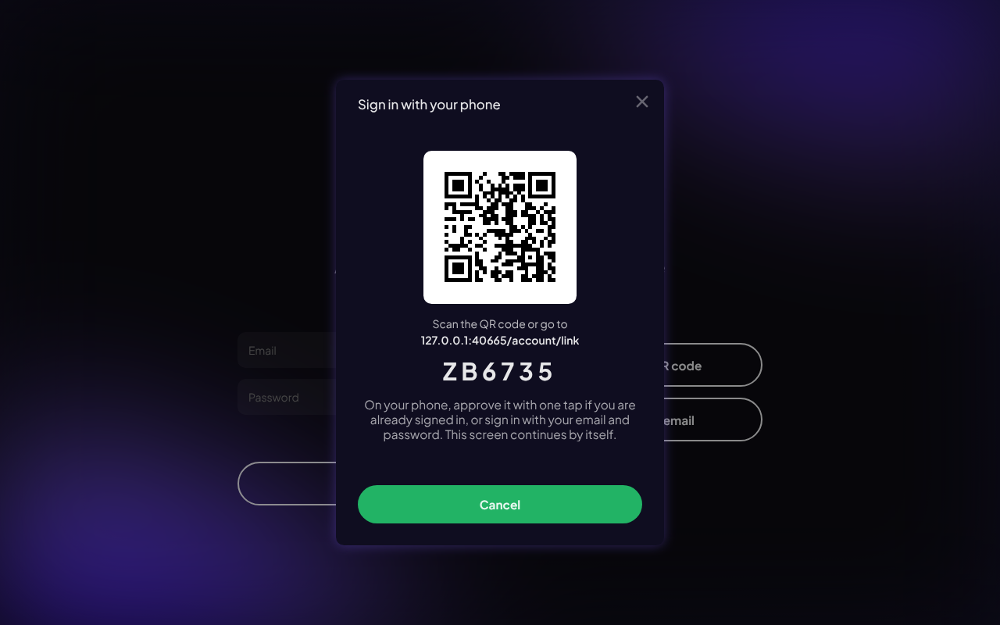

<div align="center">


# Your own streaming web app

**Accounts, library, add-ons, payments and an operator panel, all on your own server.** A white-label web app for a streaming service you run yourself.

</div>

<p align="center"></p>

## What you get

- **Your accounts, not someone else's.** Sign-up, sign-in, password reset by email, library, continue watching, add-ons, ratings, calendar feed, data export and account deletion, stored on your server (`docs/ACCOUNTS_API.md`).
- **Sign in with your phone.** QR code on the login screen; a phone that is already signed in approves with one tap.
- **Payments.** Optional paywall with Stripe, several plans, plan sharing with invited people, a grace period for failed renewals.
- **An operator panel.** Name, logo, icons, links, starting add-ons, announcements, plans, people, statistics, health checks and an audit log, all editable without a restart.
- **Other apps can switch to it by changing one address.** Apps built for the same account protocol keep working (`docs/SWITCHING_APPS.md`, tested with Alder).
- **Trakt and calendar** integrations run by you, optional.
- **Add-on powered.** Catalogs, streams and subtitles come from add-ons; they never touch the account service.

## Install

```
node tools/setup.js --domain tv.example.com
docker compose up -d --build
```

Details, backup and restore: [`docs/INSTALL.md`](docs/INSTALL.md). Settings: [`.env.example`](.env.example).

## Screenshots

The folder [`docs/screenshots`](docs/screenshots) has the numbered screens (sign-up, QR sign-in, operator panel, plans, statistics, health and more) with a table of what each shows.

## Develop

Node.js 22.13+ and pnpm 11+.

```
pnpm install
pnpm start                      # dev server on http://localhost:8080
node --test server/*.check.js tools/demo/*.check.js tools/setup.check.js
node tools/e2e/accounts.js      # real-browser run (needs a production build first)
```

| Command | Description |
|---|---|
| `pnpm start` | Development server with hot reload |
| `pnpm run build` | Production build |
| `pnpm run lint` | Lint the source |
| `node tools/branding/audit.js` | Lists third-party names and addresses still in the code |

Project notes, decisions and the task list: [`docs/README.md`](docs/README.md), progress log [`docs/PROGRESS.md`](docs/PROGRESS.md).

## Credits and license

This project is a fork of Stremio Web, the open-source web interface by Smart Code OOD, and uses the open-source [stremio-core](https://github.com/Stremio/stremio-core) engine. Copyright © 2017-2026 Smart Code OOD for the original work. Released under the GPL-2.0 license, see [LICENSE](/LICENSE.md); the source of this version must be offered to its users under the same license. Stremio is a trademark of its owner; this project is not affiliated with or endorsed by it.
